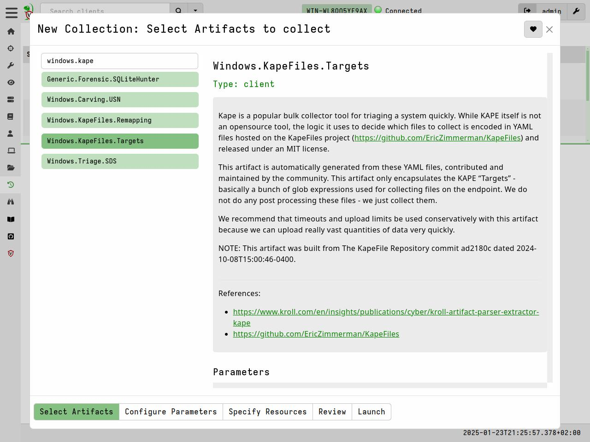
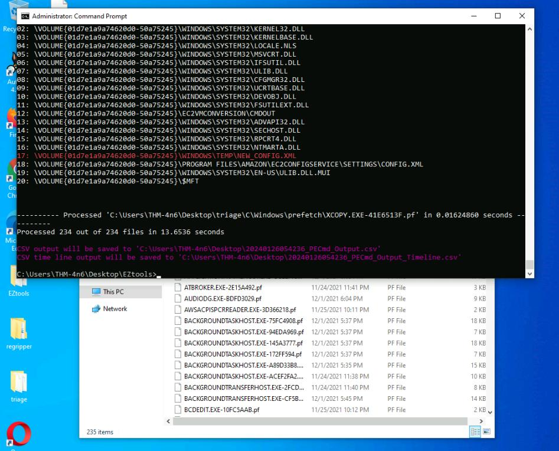
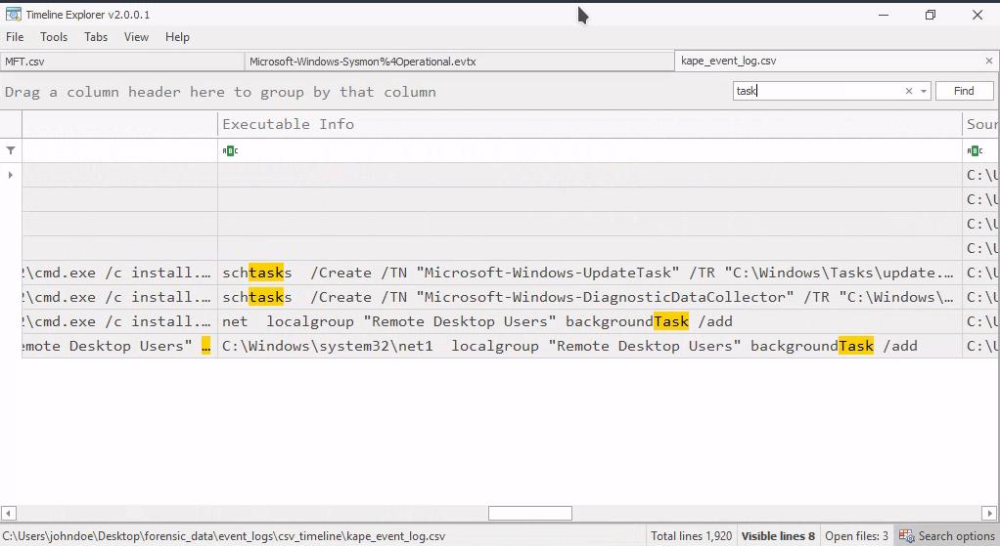

# 01 - Evidence Acquisition and Windows Artifact Analysis

## Executive Summary

This portfolio investigation documents four practical digital-forensics exercises from a controlled training environment: remote evidence acquisition with Velociraptor and KAPE, NTFS artifact analysis to trace a renamed executable, Windows event-log analysis to identify scheduled-task creation, and API Monitor examination of suspicious process activity. The exercises demonstrate an evidence-led workflow across collection, parsing, searching, correlation, and interpretation. **They are distinct lab exercises and should not be interpreted as one continuous intrusion.**

## Investigation Objectives

1. Acquire Windows forensic artifacts using Velociraptor's `Windows.KapeFiles.Targets` artifact with the `_SANS_Triage` target configuration.
2. Correlate NTFS metadata and `Zone.Identifier` information to identify a renamed executable.
3. Parse Windows event logs and identify suspicious scheduled-task creation.
4. Review API Monitor captures for process-creation and potential injection-related behavior.
5. Record what is confirmed, what is inferred, and what remains unverified.

## Scope and Lab Environment

| Component | Purpose |
|---|---|
| Velociraptor | Remote endpoint collection and forensic artifact retrieval |
| KAPE targets (`Windows.KapeFiles.Targets`) | Windows forensic triage acquisition |
| MFTECmd | Parse NTFS `$MFT` and USN Journal (`$J`) artifacts into CSV |
| Timeline Explorer | Search and correlate parsed forensic CSV files |
| EvtxECmd | Convert Windows EVTX records into searchable CSV |
| API Monitor | Examine captured Windows API calls and process behavior |
| FreeRDP | Connect to the authorized training hosts |

**Environment note**: The investigation was conducted across separate authorized Windows training environments. Velociraptor was accessed through a locally hosted console at **https://127.0.0.1:8889**. Network addresses, credentials, and endpoint configurations were specific to the training environment.

---

## Investigation 1 — Endpoint Evidence Acquisition with Velociraptor 

### Investigation Scenario

The investigation focused on remote acquisition of Windows forensic artifacts using Velociraptor and KAPE, followed by examination of collected scheduled-task artifacts to identify potentially suspicious persistence mechanisms.

### Phase 1 — Remote Access and Velociraptor Console

The analyst connected to the authorized lab endpoint over RDP and opened the local Velociraptor web interface:

```powershell
xfreerdp /v:<LAB_TARGET_IP> /u:Administrator /p:<LAB_PASSWORD> /dynamic-resolution
```

```text
https://127.0.0.1:8889/app/index.html#/search/all
```

The browser displayed a certificate trust warning (`NET::ERR_CERT_AUTHORITY_INVALID`). In this isolated training environment, the analyst selected **Advanced → Proceed to 127.0.0.1 (unsafe)** to reach the lab console. This is not a general recommendation for unknown or production websites.

### Figure 1 - Velociraptor Endpoint Selection 



### Phase 2 — Artifact Collection

The analyst filtered for the online client, opened its **Collected** tab, and started a new collection using the **+** control. The artifact **`Windows.KapeFiles.Targets`** was selected. Under **Configure Parameters**, the **`_SANS_Triage`** target group was enabled and the collection was launched.

Suggested evidence — Figure 2: Velociraptor artifact configuration displaying Windows.KapeFiles.Targets and the selected _SANS_Triage target group.

### Phase 3 — Collection Review and Export

The collection progressed from running to finished, after which the analyst prepared and downloaded the archive and extracted it to the desktop for local inspection. The finished collection screen reports approximately **1,343 MB uncompressed**, **264 MB compressed**, and **1,329 container files**. These are collection statistics, not proof of malicious activity.

Suggested evidence — Figure 3: Completed Velociraptor collection showing the finished status, collection size, and collected file count.

### Scheduled Task Examination

The extracted archive was examined under the Windows scheduled-task artifact path:

```text
uploads/auto/C%3A/Windows/System32/Tasks/
```

**Finding**: The Velociraptor collection and forensic archive export were successfully completed. The acquired dataset included the Windows scheduled-task artifact directory, enabling further examination of potential persistence mechanisms.

Evidence limitation: The available screenshots do not independently establish the identity or contents of a specific suspicious scheduled task from this acquisition.

---

## Investigation 2 — NTFS File Rename and Zone.Identifier Correlation

### Investigation Scenario

The investigation examined NTFS filesystem metadata and alternate data streams to trace executable filename changes and identify potentially suspicious file-renaming activity.

### Phase 1 — Parse NTFS Artifacts

Using Eric Zimmerman's `MFTECmd`, the analyst converted the USN Journal and Master File Table into CSV datasets for review:

```powershell
cd C:\Users\johndoe\Desktop\Get-ZimmermanTools\net6

.\MFTECmd.exe -f "C:\Users\johndoe\Desktop\forensic_data\kape_output\D\$Extend\$J" --csv "C:\Users\johndoe\Desktop\forensic_data\mft_analysis" --csvf MFT-J.csv

.\MFTECmd.exe -f "C:\Users\johndoe\Desktop\forensic_data\kape_output\D\$MFT" --csv "C:\Users\johndoe\Desktop\forensic_data\mft_analysis" --csvf MFT.csv
```

The PowerShell output confirms that both `UsnJournal` and `Mft` input types were processed and CSV outputs were generated.

### Figure 2 - NTFS Artifact Parsing with MFTECmd 



### Phase 2 — Correlate File Name and Alternate Data Stream

In **Timeline Explorer**, a search for `uninstall.exe` exposed an entry associated with the alternate data stream:

```text
microsoft.windowskits.feedback.exe:Zone.Identifier
```

**Finding:** `microsoft.windowskits.feedback.exe` is the renamed executable identified by the lab's artifact correlation. The `Zone.Identifier` stream is useful contextual metadata; the screenshot supports the name association, while a full USN rename sequence would provide stronger chronological proof.

Suggested evidence — Figure 5: Timeline Explorer search results showing the relationship between uninstall.exe and microsoft.windowskits.feedback.exe:Zone.Identifier.

---

## Investigation 3 — Scheduled Task Creation from Windows Event Logs (Module Question 3.B)

### Investigation Scenario

The investigation analyzed Windows event-log artifacts to identify scheduled-task creation activity and assess potential persistence indicators through command-line evidence.

### Phase 1 — Convert EVTX to CSV

The analyst used **EvtxECmd** to parse the collected Windows event log into a CSV file:

```powershell
C:\Users\johndoe\Desktop\Get-ZimmermanTools\net6\EvtxECmd\EvtxECmd.exe -f "C:\Users\johndoe\Desktop\forensic_data\kape_output\D\Windows\System32\winevt\logs\Microsoft-Windows-Sysmon%4Operational.evtx" --csv "C:\Users\johndoe\Desktop\forensic_data\event_logs\csv_timeline" --csvf kape_event_log.csv
```

Evidence limitation: The available command record contains an EVTX filename variant that has not been independently confirmed against the source directory. Successful event-log parsing was observed, but the exact source filename should be verified before reproducing the command.

Suggested evidence — Figure 6: EvtxECmd output showing event-log parsing and CSV generation.

### Phase 2 — Search for Scheduled Task Creation

The CSV was opened in Timeline Explorer and searched for `schtasks`. The **Executable Info** column contained task-creation commands, including:

```text
schtasks /Create /TN "Microsoft-Windows-UpdateTask" ...
schtasks /Create /TN "Microsoft-Windows-DiagnosticDataCollector" ...
```
### Figure 3 - Scheduled Task Creation Evidence 



**Finding**: Event-log analysis identified scheduled-task creation activity involving **Microsoft-Windows-DiagnosticDataCollector**. The observed command lines provide evidence of task-registration attempts. Determining malicious intent requires additional correlation with the task action, executable path, creator, and surrounding event records.

---

## Investigation 4 — Suspicious Process Activity in API Monitor (Module Question 3.C)

### Investigation Scenario

The investigation examined a captured API Monitor session associated with **discord.exe** to assess process-creation behavior and evaluate indicators potentially associated with process injection.

### Phase 1 — Load the API Capture

The analyst launched the 64-bit API Monitor application and opened the capture:

```text
C:\Users\johndoe\Desktop\forensic_data\APMX64\discord.apmx64
```

The loaded session contains API call records and monitored processes, including `discord.exe`.

Suggested evidence — Figure 8: API Monitor capture showing the monitored processes and the recorded CreateProcessA API call.

### Phase 2 — Process Activity and Injection Hypothesis

A `CreateProcessA` call is visible in the supplied capture, with an application path referencing `C:\Windows\System32\comp.exe`. 

The investigation notes also reference **cmdkey.exe** as a potentially relevant process. However, the available API Monitor screenshots do not independently establish that this process was targeted by injection activity.

**Analytical distinction:** `CreateProcessA` establishes process creation, **not process injection by itself**. To substantiate injection, examine the full call sequence for relevant cross-process APIs such as `OpenProcess`, `VirtualAllocEx`, `WriteProcessMemory`, and `CreateRemoteThread` (or equivalent techniques), including the target PID and return values. 

**Finding**: The API Monitor capture confirms process-creation activity associated with the recorded session. Evidence of a complete process-injection sequence remains unverified.

---

## Evidence Summary

The following table consolidates the observed evidence and outstanding verification gaps across the four investigations.

| Exercise | Data source | Confirmed observation | Status |
|---|---|---|---|
| Endpoint Acquisition | Velociraptor / KAPE collection | `_SANS_Triage` collection completed and archive downloaded | Collection verified; specific task identity unconfirmed |
| NTFS artifact analysis | `$MFT`, USN Journal, `Zone.Identifier` | `microsoft.windowskits.feedback.exe:Zone.Identifier` associated with `uninstall.exe` search | Renamed filename identified |
| Scheduled task analysis | EVTX → CSV, Timeline Explorer | `schtasks /Create` for `Microsoft-Windows-DiagnosticDataCollector` | Task name verified |
| API behaviour analysis | `discord.apmx64` | `CreateProcessA` call and `comp.exe` path visible | Process creation observed; injection not independently verified |

## MITRE ATT&CK Considerations

The following are **investigative hypotheses**, not confirmed technique attributions:

| Technique | ID | Relevance | Evidence limitation |
|---|---|---|---|
| Scheduled Task/Job: Scheduled Task | T1053.005 | Task-creation commands observed in parsed event data | Execution purpose and adversary attribution not established |
| Masquerading: Rename System Utilities | T1036.003 | A renamed executable was investigated | Need to establish whether the renamed file actually impersonated a system utility |
| Process Injection | T1055 | Potential injection-related behaviour investigated through API Monitor | Supplied screenshot shows process creation, not the complete injection sequence |

## Detection and Investigation Opportunities

- Monitor Windows scheduled-task registration and `schtasks /Create` activity, correlating the task name, action, author, parent process, and timestamp.
- Preserve `$MFT`, USN Journal, and alternate data streams when investigating file rename or masquerading hypotheses.
- Correlate suspicious executable names with their original filenames, file hashes, signatures, and provenance metadata.
- Distinguish process creation from process injection; seek cross-process memory-write and execution evidence before escalating a T1055 finding.
- Preserve collection metadata, acquisition timestamps, tool versions, and file hashes to strengthen forensic reproducibility.

## Investigation Outcome

The investigation demonstrated successful remote evidence acquisition, NTFS artifact parsing, Windows event-log analysis, and API-call inspection across separate forensic scenarios.

Key findings included the identification of **microsoft.windowskits.feedback.exe** through NTFS metadata correlation and the observation of scheduled-task creation activity involving **Microsoft-Windows-DiagnosticDataCollector**.

The investigation also highlighted evidence limitations: the specific scheduled-task identity from the initial acquisition was not independently established, and the API Monitor capture did not provide sufficient evidence to confirm process injection.

## Conclusion

This project demonstrates foundational endpoint DFIR capabilities across evidence acquisition, filesystem metadata, Windows event logs, and behavioral API traces. By documenting both results and verification gaps, it emphasizes a core forensic principle: **observed artifacts must be distinguished from inferred attacker behavior**.
